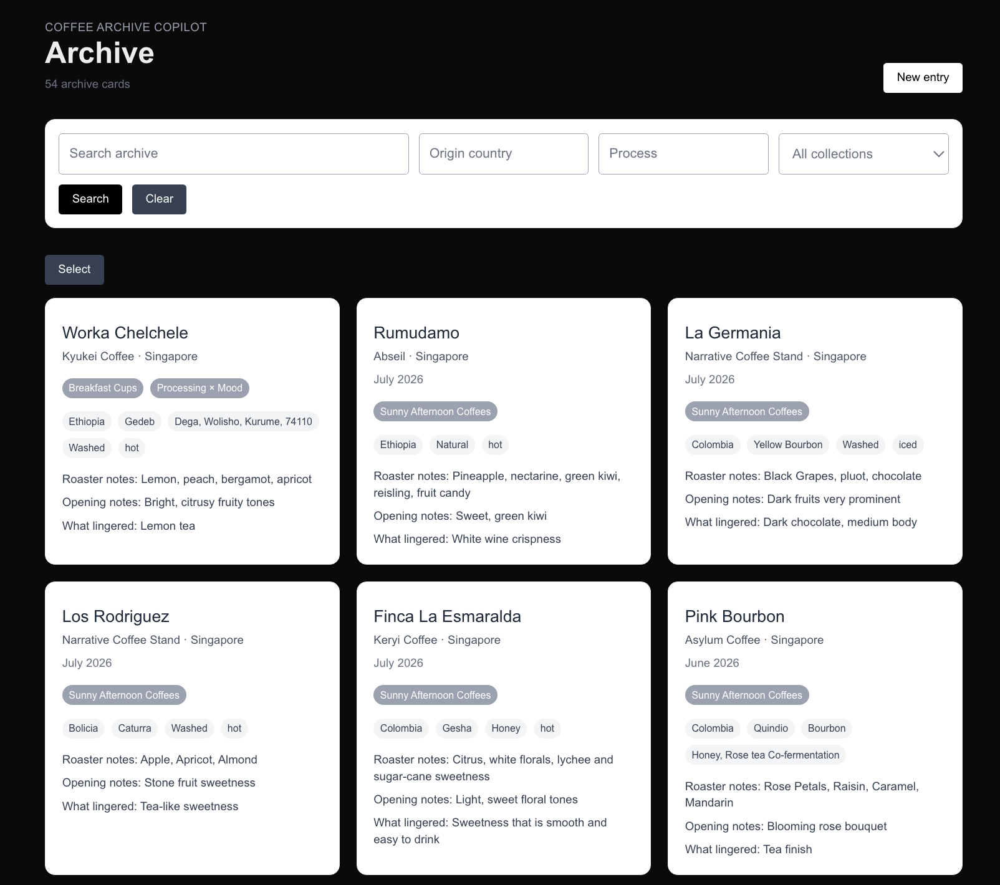
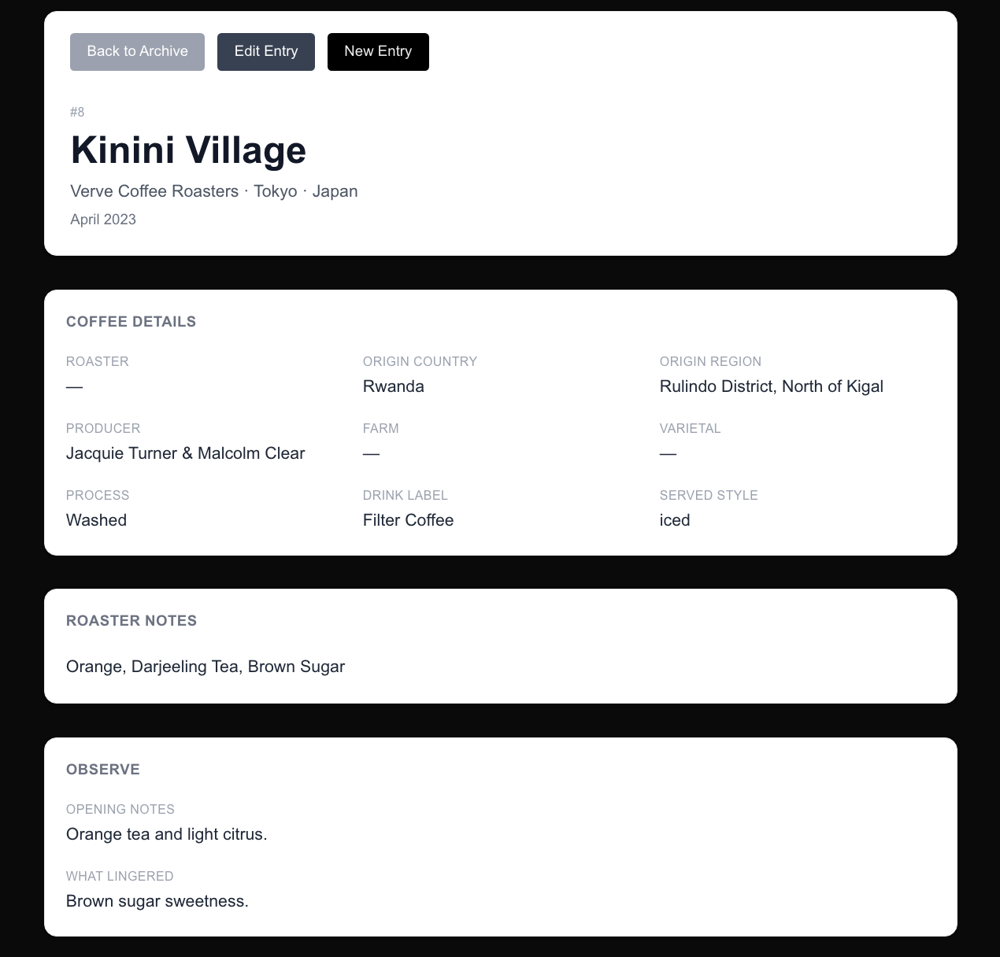
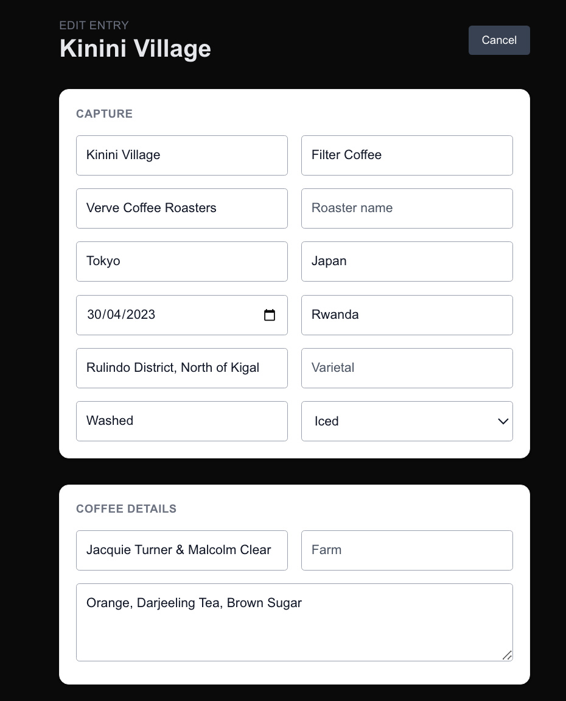

# coffee-archive-copilot

A private coffee archive for capturing, organizing, and revisiting coffee experiences.

`coffee-archive-copilot` turns scattered coffee notes into structured archive cards. Each entry can hold bean details, roaster notes, opening notes, what lingered, café or place context, collections, and interpretation fields.

The project is based on a simple idea:

> Archive is infrastructure.  
> Interpretation is the product.  
> Learning is the outcome.

Build v1.0 focuses on the archive itself: creating entries, editing them, browsing the archive, searching, filtering, and grouping coffees through collections.

Future builds will add photo upload, AI-assisted tagging, and a Perspective Engine for reading across archive patterns.

---

## Screenshots

### Archive Homepage



Searchable archive homepage with filters, collection chips, and archive card count.

### Entry Detail Page



Structured entry page for reviewing bean details, tasting notes, context, and collections.

### Edit Entry Page



Edit form for updating coffee notes, metadata, collections, and interpretation fields.

---

## What This App Does

* captures coffee experiences as structured archive cards
* records bean details, roaster notes, opening notes, and what lingered
* stores café, place, date, process, origin, and variety metadata
* supports entry creation, editing, and detail views
* organizes entries through collections
* displays collection chips on archive cards
* supports search, filtering, and sorting
* includes select mode and delete-selected workflow
* runs as a private deployed web app

---

## Product Philosophy

A coffee entry is not only a tasting record.

It can also capture:

* where the coffee was experienced
* what was noticed in the cup
* what changed from first sip to finish
* what context surrounded the coffee
* how the entry connects to other cups over time

The archive exists so interpretation can happen later.

The current product is intentionally simple: preserve the coffee experience first, then leave room for patterns to emerge across entries.

---

## Core Workflow

```text
Capture → Archive → Revisit → Interpret
```

**Capture**  
Record the coffee experience while it is still fresh.

**Archive**  
Store the entry with structured notes, metadata, and collections.

**Revisit**  
Search, filter, and browse entries across time.

**Interpret**  
Use the archive to notice repeated patterns, possible themes, and future writing ideas.

---

## Current Build Status

### Build v1.0 — Coffee Archive

Status: **Current release**

Build v1.0 is a working private coffee archive.

Implemented:

* Next.js app setup
* PostgreSQL database
* Prisma schema
* Prisma 7 with PrismaPg adapter
* create entry form
* entry detail page
* edit entry page
* archive homepage
* archive card grid
* opening notes / what lingered workflow
* roaster notes and personal impressions
* search by keyword
* filters by origin, process, and collection
* sorting by date tried and creation date
* collection assignment from edit page
* collection display on detail page
* collection chips on archive cards
* archive card count
* select mode
* delete selected entries
* pending / saving state for forms
* private Vercel deployment
* Basic Auth protection

### Build v2.0 — Photo Upload + Tagging

Status: **Planned**

Build v2.0 will add a media layer and tagging workflow.

Planned scope:

* upload cup photos
* upload place / room photos
* select hero image for archive cards
* display thumbnails on archive grid
* display larger images on entry detail pages
* replace or remove photos
* add manual visual / activity labels
* suggest labels from photos
* review and edit suggested labels

Example labels:

* cup with book
* cup with notebook
* travel cup
* paper cup walk
* window seat
* home brew
* coffee before art
* solo table
* memory anchor

### Build v3.0 — Perspective Engine

Status: **Planned**

Build v3.0 will add an interpretation layer on top of the archive.

Planned scope:

* generate perspective fragments from selected entries, collections, or the full archive
* use tasting notes, lingering notes, roaster notes, process, origin, collections, and photo labels
* show supporting entries for each generated perspective
* save, edit, copy, or reject generated fragments
* promote useful fragments into Archive Notes or hypotheses

Example perspective fragment:

> Some coffees are not the subject of attention. They are what makes attention possible.

---

## Example Collections

* Coffee Before Art
* Tokyo Cups
* Hong Kong Cups
* Taipei Cups
* Taichung Cups
* Rainy Afternoon Coffees
* Sunny Afternoon Coffees
* Processing × Mood

---

## Tech Stack

Current:

* Next.js
* TypeScript
* Tailwind CSS
* PostgreSQL
* Prisma 7
* PrismaPg adapter
* Vercel
* Basic Auth

Planned:

* Vercel Blob or equivalent object storage
* OpenAI API or equivalent LLM / vision model provider
* structured AI outputs for photo tags and perspective fragments

---

## MVP Scope

Current MVP (v1.0 release):

* private responsive web app
* archive CRUD
* entry detail pages
* edit entry pages
* archive card grid
* opening notes
* what lingered
* roaster notes
* process / origin metadata
* collections
* search / filter / sort
* archive card count
* safe delete workflow
* mobile-friendly browsing and editing
* deployed private access

Next builds:

* photo upload
* photo display on archive cards and detail pages
* visual / activity labels
* AI-assisted photo tagging
* Perspective Engine prototype
* save / edit / reject perspective fragments

---

## Long-Term Direction

The long-term goal is to turn scattered coffee experiences into a creative archive that can answer questions such as:

* What cups do I remember most?
* Which coffees stay as flavor, and which stay as place?
* What patterns appear across process, origin, mood, and context?
* Which entries could become Bean Notes, Field Notes, Memory Trips, or Archive Notes?
* What archive fragments could become Notes on Bean posts?

Build v1.0 proves the archive foundation.

Future builds can add richer media, tagging, and interpretation layers on top of it.
